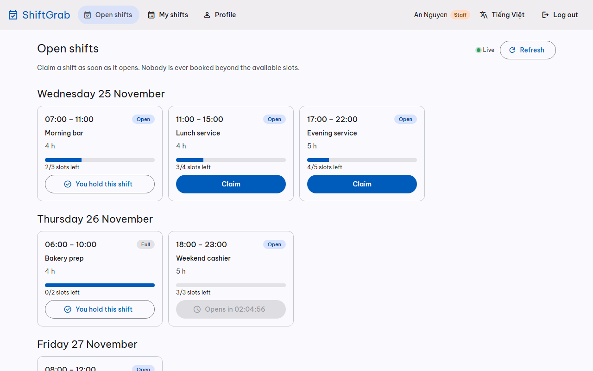
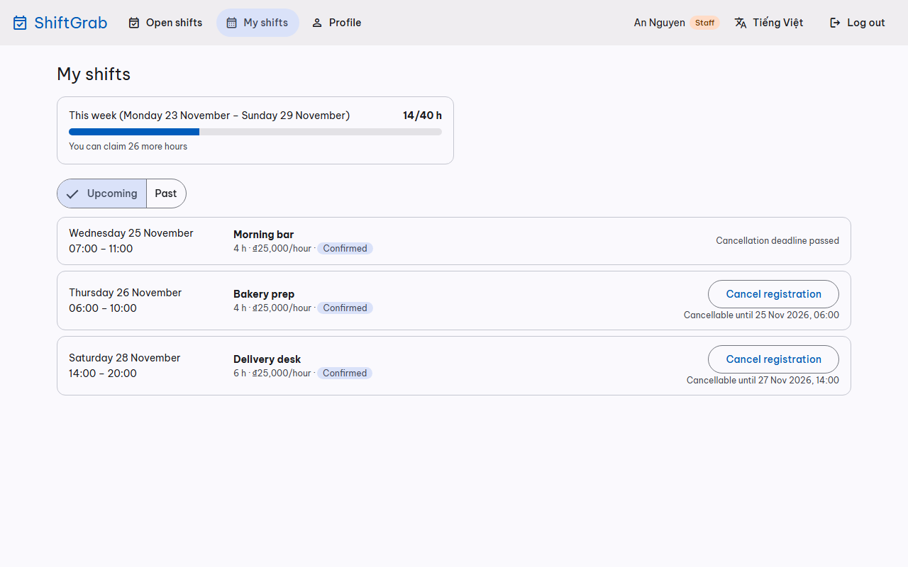
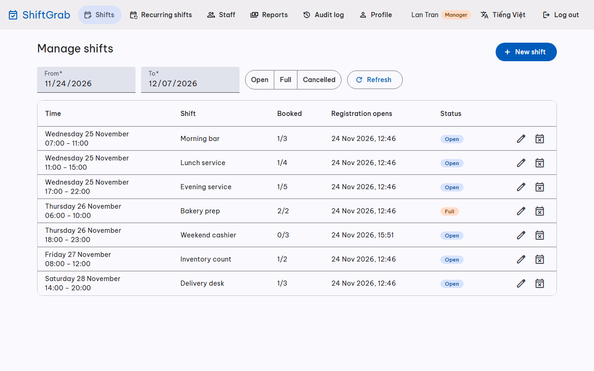
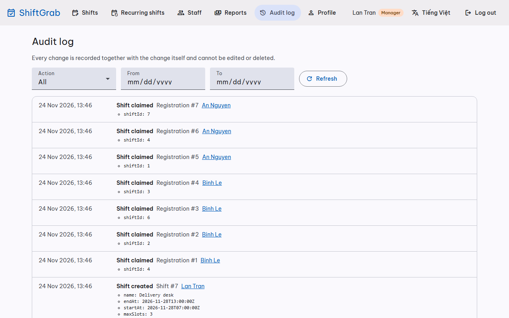
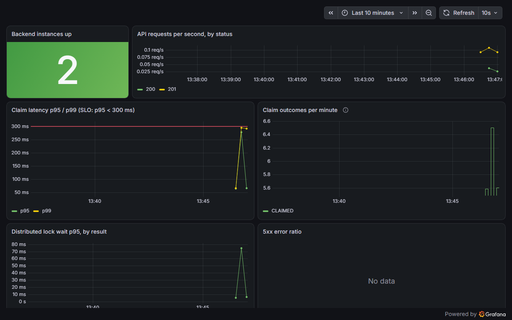
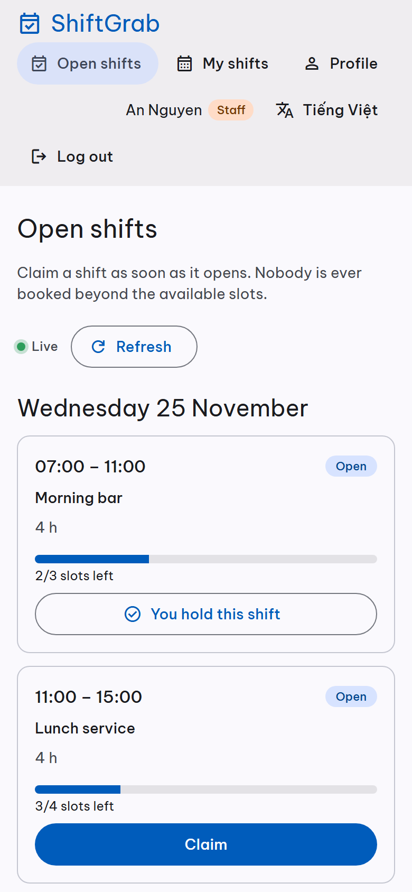
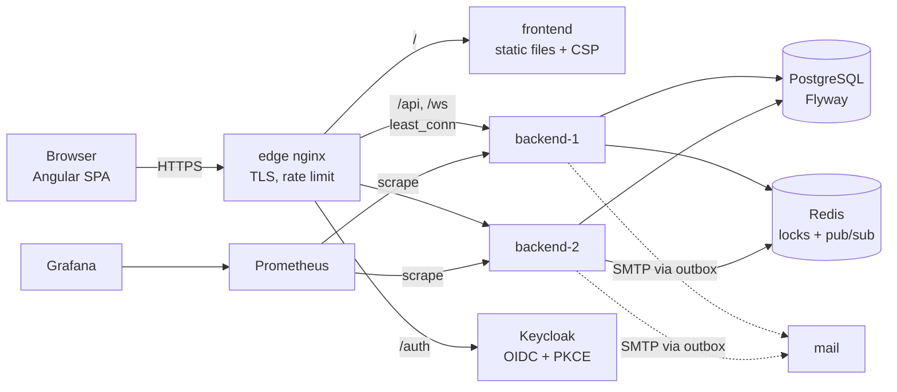

# ShiftGrab: shift registration that never overbooks

> 🇻🇳 [Đọc bản tiếng Việt](README.vi.md)

[](https://github.com/LukastGeorge/Automated-Shift-Registration-Claiming-System-ShiftGrab-/actions/workflows/ci-backend.yml)
[](https://github.com/LukastGeorge/Automated-Shift-Registration-Claiming-System-ShiftGrab-/actions/workflows/ci-frontend.yml)
[](https://github.com/LukastGeorge/Automated-Shift-Registration-Claiming-System-ShiftGrab-/actions/workflows/e2e.yml)
[](https://github.com/LukastGeorge/Automated-Shift-Registration-Claiming-System-ShiftGrab-/actions/workflows/security.yml)

Managers publish work shifts with a limited number of slots; staff **claim them the moment registration opens**, a
"flash sale" for shifts. The hard part is **correctness under contention**: when hundreds of people press *Claim* in
the same second, no shift may be overbooked, nobody may hold two overlapping shifts, and weekly hour limits must hold,
across several server instances.


*A colleague claims "Brunch service" on another device and this screen updates by itself (WebSocket); then this
user claims "Closing shift".*

## Highlights

| | |
|---|---|
| **Zero overbooking under load** | k6 flash sale: **1000 users** claim 50 slots at the same instant through nginx and two backends. Exactly 50 succeed, 0 overbooked, 0 errors, verified in the database ([report](load-tests/results/02-tuning.md)) |
| **Defence in depth** | Distributed lock per user (Redis) → conditional `UPDATE … WHERE booked < max AND version = ?` → database constraints (`EXCLUDE` on overlapping times, partial unique index) ([ADR-0005](docs/adr/0005-overbooking-defence-in-depth.md)) |
| **Measured, not guessed** | The baseline was p95 6.1 s with 138 errors. Measuring showed the per-shift lock serialising every claim; the fix took errors to 0 and server-side worst case to 1.26 s ([ADR-0004 revision](docs/adr/0004-redis-distributed-lock.md#revision-sg-81-2026-11-23-lock-the-user-not-the-shift)) |
| **Real-time** | STOMP over WebSocket, fanned out across instances through Redis pub/sub; newest update wins |
| **Reliable side effects** | Transactional outbox (Spring Modulith): e-mails are never lost and never sent for a rolled-back claim ([ADR-0007](docs/adr/0007-transactional-outbox-for-side-effects.md)) |
| **Tested at every level** | 180+ backend tests (Testcontainers: PostgreSQL, Redis, Keycloak, Mailpit), 87 frontend tests, and Playwright E2E on the real production stack. The E2E suite found two real bugs before release |
| **Secure by default** | Keycloak OIDC + PKCE, role checks before validation, strict CSP, login rate limit, append-only audit log; reviewed against [OWASP Top 10:2025](docs/security/owasp-top10-review.md) |
| **Operable** | Prometheus + Grafana, alert rules, daily backups with a tested restore (15 s), rolling deploys with automatic rollback, [runbooks](docs/runbook/operations.md) |

## Screenshots

| Staff: open shifts | Staff: my shifts |
|---|---|
|  |  |
| **Manager: shifts** | **Manager: audit log** |
|  |  |
| **Monitoring (Grafana)** | **Phone (360 px and up)** |
|  |  |

The screenshots and the GIF are generated by Playwright from a fresh stack ([`e2e/docs`](e2e/docs)), so they can be
regenerated after any UI change.

## Quick start: the full stack on your machine

Requirements: Docker Desktop (about 4 GB of RAM for Docker). Three commands:

```bash
docker build -t local/shiftgrab-backend:dev backend
docker build -t local/shiftgrab-frontend:dev frontend
docker compose -f infra/docker/docker-compose.prod.yml --env-file infra/docker/.env.local.example up -d --wait
```

Open **http://localhost:8088** (Keycloak needs about half a minute more to import its realm on the first start).

| Account | Password | Can |
|---|---|---|
| `manager` | `manager123` | create, edit and cancel shifts, recurring shifts, staff rates, hours & pay report (CSV/XLSX), audit log |
| `staff1`, `staff2` | `staff123` | claim and cancel shifts, see their week |

Grafana: http://localhost:8088/grafana/ (read-only dashboards in this setup). To stop and delete everything:
`docker compose -f infra/docker/docker-compose.prod.yml --env-file infra/docker/.env.local.example down -v`.

For development with hot reload (backend and frontend outside Docker), see [local development](docs/runbook/local-development.md).

## Architecture



A **modular monolith** (Spring Modulith, module boundaries verified by tests): `identity`, `shift`, `registration`,
`notification`, `realtime`, `reporting`, `audit`. Two stateless instances run behind the edge to prove horizontal
scaling and cross-instance correctness. Details: [architecture](docs/design/architecture.md) ·
[decisions (ADRs)](docs/adr) · [requirements (SRS)](docs/srs/SRS.md).

### How a claim stays correct

1. **Fast path:** a shift already known to be full is answered at once (a per-instance memo; it can only refuse, never grant).
2. **Lock the person:** a Redis lock on `user:{id}` makes one person's rules (overlap, 40 h per week, no double claim) read a consistent state across instances.
3. **Atomic reservation:** one `UPDATE` takes a slot only if one is free and the shift has not changed since the rules were checked. PostgreSQL's row lock orders the claims on a shift, bounded by `lock_timeout`.
4. **Constraints:** a `CHECK`, a partial unique index and an `EXCLUDE` constraint on time ranges reject what slipped through any layer above.

Each layer is tested on its own with the others removed ([`DefenceLayerTests`](backend/src/test/java/com/shiftgrab/concurrency/DefenceLayerTests.java)).

## Tech stack

| Area | Technology |
|---|---|
| Backend | Java 21, Spring Boot 4.1, Spring Modulith 2.1, Spring Security (OAuth2 resource server), JdbcClient, Flyway, Redisson, ShedLock, Apache POI |
| Frontend | Angular 22 (standalone, zoneless, signals), Angular Material, keycloak-js, STOMP, Vitest |
| Data & infra | PostgreSQL 16, Redis 8, Keycloak 26, nginx, Docker Compose, Let's Encrypt |
| Observability | Micrometer, Prometheus 3, Grafana 13 (dashboards and alerts as code) |
| Testing | JUnit 5, Testcontainers, Mockito, JaCoCo (≥ 70 % lines), Playwright, k6 |
| CI/CD | GitHub Actions: build and test, CodeQL, Trivy, ShellCheck, E2E; images to GHCR with SBOM and provenance; SSH deploy with rolling update and rollback |

## How the project was run

Built as a one-person Scrum project in ten one-week sprints, the way a team would work:

- A backlog of user stories with acceptance criteria (GitHub Projects).
- Git Flow with one pull request per story, Conventional Commits, and required CI checks (E2E required before every release).
- Semantic versioning with a [changelog](CHANGELOG.md).
- Architecture decisions recorded as [ADRs](docs/adr), including one *revised* after load testing proved the original assumption wrong.

## Documentation

| | |
|---|---|
| [SRS (en)](docs/srs/SRS.md) · [SRS (vi)](docs/srs/SRS.vi.md) | Requirements, business rules, error contract |
| [Architecture](docs/design/architecture.md) · [ADRs](docs/adr) | C4 views, ERD, claim sequence; seven decisions |
| [Production runbook](docs/runbook/production.md) · [Operations runbook](docs/runbook/operations.md) | Deploy, backup, restore; incidents and secret rotation |
| [Load tests](load-tests/README.md) · [E2E tests](e2e/README.md) | How to run them, and the results |
| [Security review](docs/security/owasp-top10-review.md) | OWASP Top 10:2025 checklist, findings and fixes |

## What I would do next

- Deploy to a VPS (the CD pipeline is ready and switched off) and measure NFR-02 there, with k6 on a separate machine.
- A more compact navigation bar on phones (the layout works down to 360 px, but the header takes a lot of room).
- Alertmanager routing to e-mail or chat, an off-site copy of backups, and an OWASP ZAP baseline scan in CI.

## Repository layout

```
backend/      Spring Boot application (modules under com.shiftgrab.*)
frontend/     Angular application
e2e/          Playwright end-to-end tests and the README screenshot scripts
load-tests/   k6 flash-sale scenario and results
infra/        Compose files, nginx, Keycloak realms, Prometheus, Grafana, backup and deploy scripts
docs/         SRS, design, ADRs, runbooks, security review, images
```

Contributions follow [CONTRIBUTING.md](CONTRIBUTING.md).
