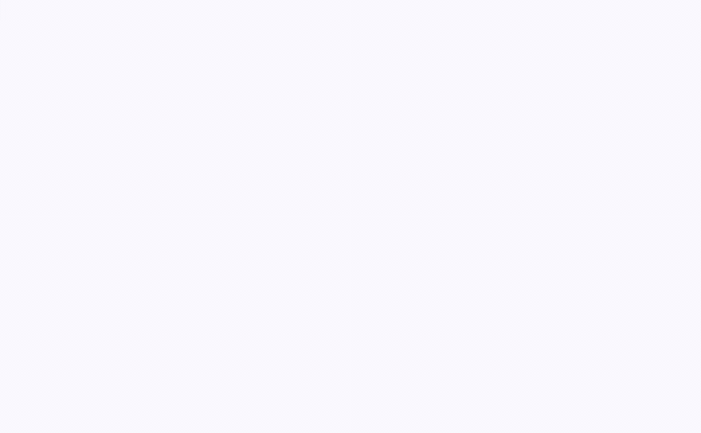
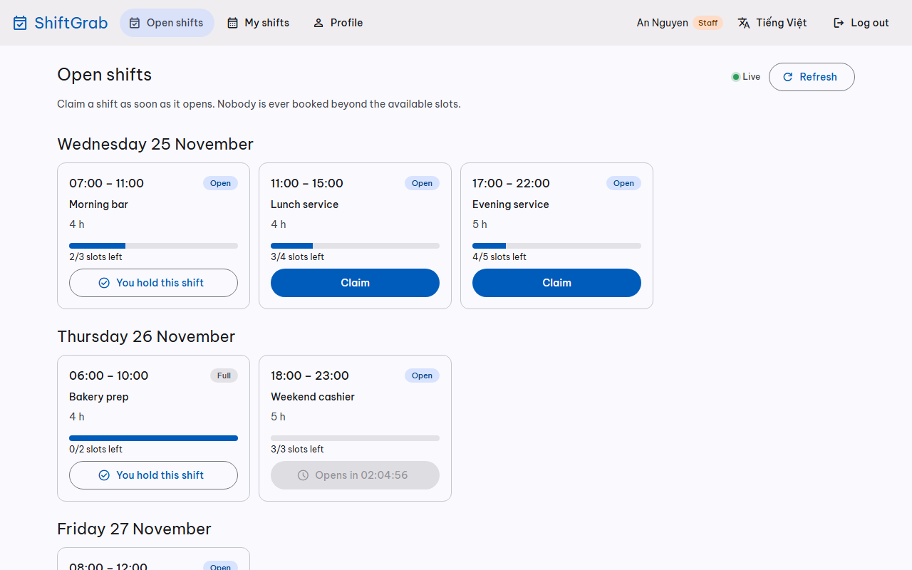
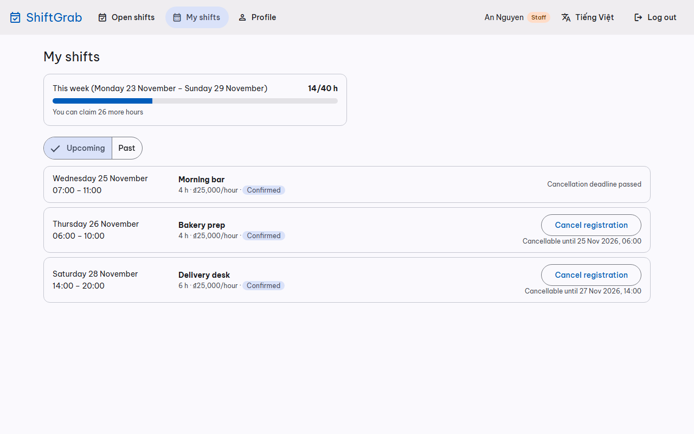
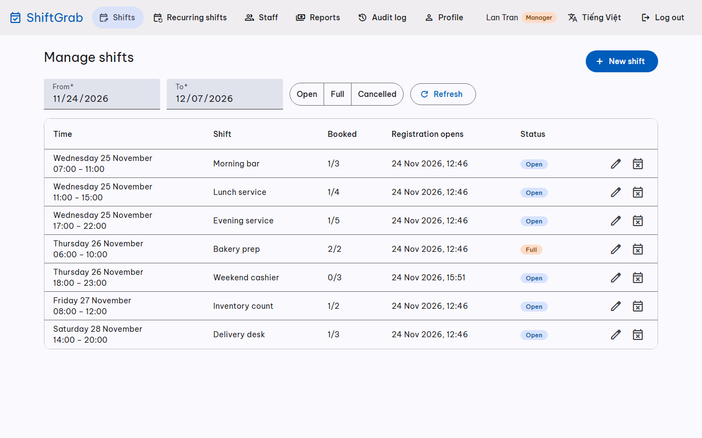
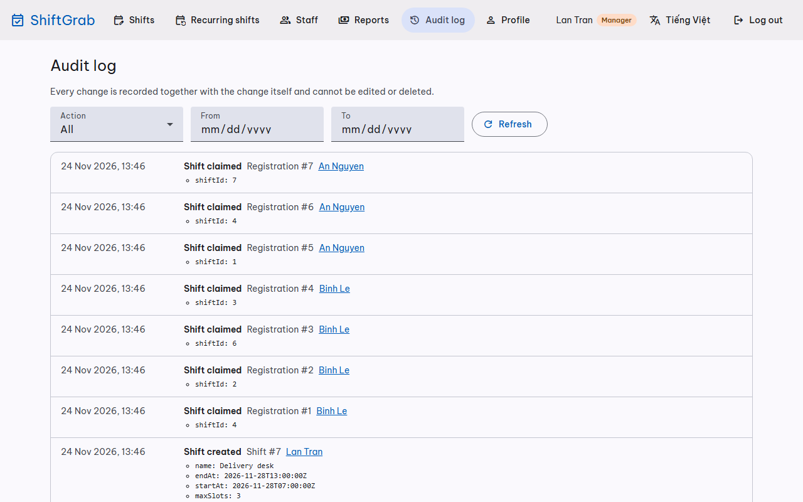
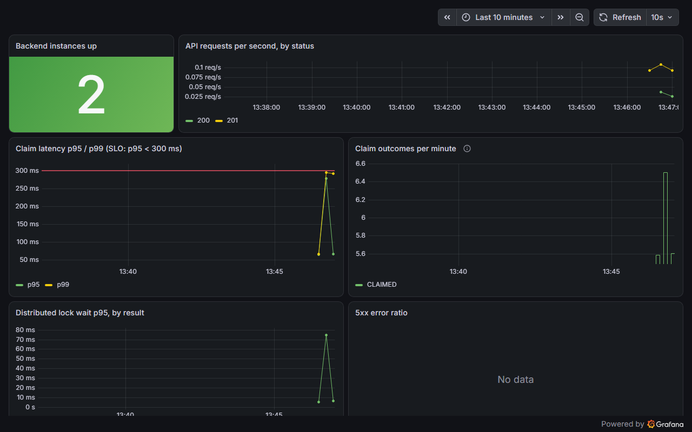
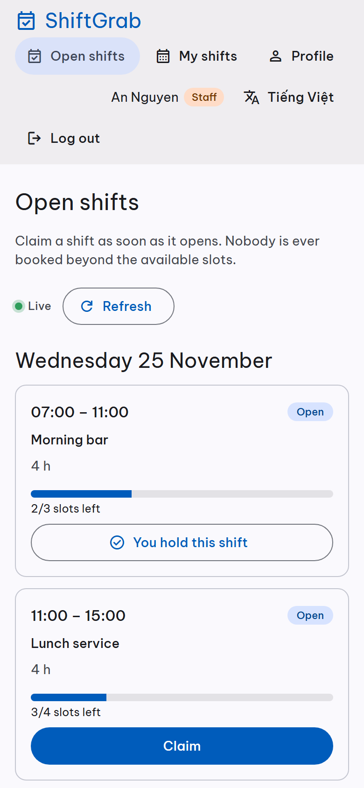
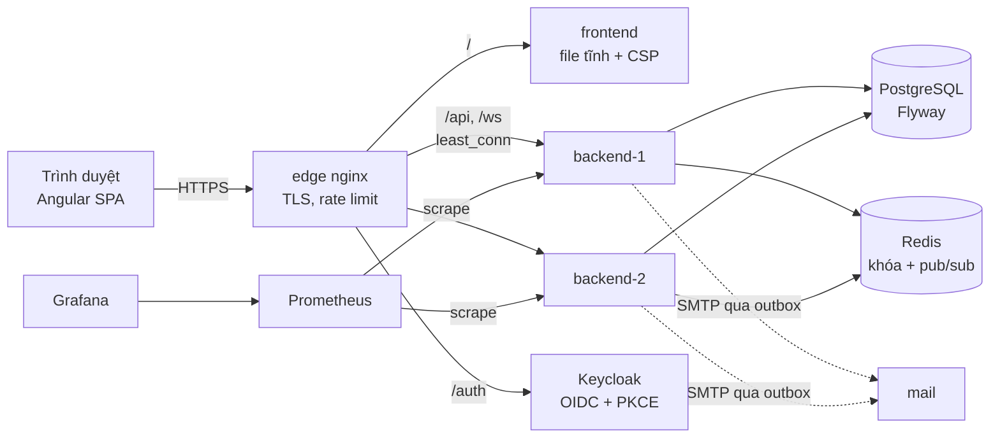

# ShiftGrab: hệ thống đăng ký ca không bao giờ đặt quá suất

> 🇬🇧 [English version](README.md)

Quản lý đăng các ca làm việc với số suất giới hạn. Nhân viên **giành ca ngay khi giờ mở đăng ký đến**, giống một đợt
"flash sale" cho ca làm. Phần khó nằm ở **tính đúng đắn khi tranh chấp**: khi hàng trăm người cùng bấm *Giành* trong
một giây, thì:
- không ca nào được đặt quá số suất;
- không ai giữ hai ca trùng giờ;
- hạn mức giờ mỗi tuần vẫn được giữ đúng;

và tất cả phải đúng trên nhiều instance server chạy song song.



*Một đồng nghiệp giành "Brunch service" trên thiết bị khác, màn hình này tự cập nhật (WebSocket); sau đó người dùng
giành "Closing shift".*

## Điểm nổi bật

| | |
|---|---|
| **0 overbooking dưới tải lớn** | k6 flash sale: **1000 người** cùng giành 50 suất qua nginx và 2 backend. Đúng 50 lượt thành công, 0 đặt quá suất, 0 lỗi, kiểm chứng trực tiếp trong database ([báo cáo](load-tests/results/02-tuning.md)) |
| **Phòng thủ nhiều lớp** | Khóa phân tán theo user (Redis) → `UPDATE … WHERE booked < max AND version = ?` có điều kiện → ràng buộc database (`EXCLUDE` chặn trùng giờ, partial unique index) ([ADR-0005](docs/adr/0005-overbooking-defence-in-depth.md)) |
| **Đo, không đoán** | Ban đầu: p95 6,1 s, 138 lỗi. Số đo cho thấy khóa theo ca bắt mọi lượt giành đi tuần tự; sau khi sửa còn 0 lỗi, lượt chậm nhất phía server 1,26 s ([sửa đổi ADR-0004](docs/adr/0004-redis-distributed-lock.md)) |
| **Thời gian thực** | STOMP qua WebSocket, đồng bộ giữa các instance bằng Redis pub/sub; bản cập nhật mới nhất luôn thắng |
| **Tác vụ phụ tin cậy** | Transactional outbox (Spring Modulith): email không bao giờ mất, và không bao giờ gửi cho lượt giành đã rollback ([ADR-0007](docs/adr/0007-transactional-outbox-for-side-effects.md)) |
| **Kiểm thử mọi tầng** | 180+ test backend (Testcontainers: PostgreSQL, Redis, Keycloak, Mailpit), 87 test frontend, E2E Playwright trên đúng stack production. E2E đã bắt được 2 bug thật trước khi phát hành |
| **Bảo mật mặc định** | Keycloak OIDC + PKCE, kiểm tra quyền trước khi validate, CSP chặt, giới hạn tốc độ đăng nhập, audit log chỉ-thêm; rà soát theo [OWASP Top 10:2025](docs/security/owasp-top10-review.md) |
| **Vận hành được** | Prometheus + Grafana, cảnh báo, backup hằng ngày có diễn tập restore (15 s), deploy cuốn chiếu có tự rollback, [runbook](docs/runbook/operations.md) |

## Ảnh chụp màn hình

| Nhân viên: ca còn trống | Nhân viên: ca của tôi |
|---|---|
|  |  |
| **Quản lý: danh sách ca** | **Quản lý: audit log** |
|  |  |
| **Giám sát (Grafana)** | **Điện thoại (từ 360 px)** |
|  |  |

Ảnh và GIF được Playwright tạo tự động từ một stack sạch ([`e2e/docs`](e2e/docs)), nên có thể chụp lại sau mỗi lần
đổi giao diện. Giao diện có cả tiếng Việt và tiếng Anh; ảnh dùng tiếng Anh.

## Chạy thử toàn bộ hệ thống trên máy

Yêu cầu: Docker Desktop (cấp khoảng 4 GB RAM cho Docker). Chỉ 3 lệnh:

```bash
docker build -t local/shiftgrab-backend:dev backend
docker build -t local/shiftgrab-frontend:dev frontend
docker compose -f infra/docker/docker-compose.prod.yml --env-file infra/docker/.env.local.example up -d --wait
```

Mở **http://localhost:8088**. Lần đầu Keycloak cần thêm khoảng nửa phút để import realm.

| Tài khoản | Mật khẩu | Quyền |
|---|---|---|
| `manager` | `manager123` | tạo, sửa, hủy ca; ca lặp lại; đơn giá nhân viên; báo cáo giờ công và lương (CSV/XLSX); audit log |
| `staff1`, `staff2` | `staff123` | giành và hủy ca, xem giờ làm trong tuần |

Grafana: http://localhost:8088/grafana/ (chế độ chỉ xem). Dừng và xóa toàn bộ:
`docker compose -f infra/docker/docker-compose.prod.yml --env-file infra/docker/.env.local.example down -v`.

Để phát triển có hot reload (backend và frontend chạy ngoài Docker), xem [chạy local](docs/runbook/local-development.md).

## Kiến trúc



Hệ thống là một **modular monolith** (Spring Modulith; ranh giới module được kiểm tra bằng test) gồm các module
`identity`, `shift`, `registration`, `notification`, `realtime`, `reporting`, `audit`. Hai instance stateless chạy sau
edge để chứng minh khả năng mở rộng ngang và tính đúng đắn giữa các instance.

Chi tiết: [kiến trúc](docs/design/architecture.md) · [quyết định thiết kế (ADR)](docs/adr) ·
[yêu cầu (SRS)](docs/srs/SRS.vi.md).

### Một lượt giành ca được giữ đúng thế nào

1. **Đường tắt:** ca đã biết là đầy được trả lời ngay. Mỗi instance có một bộ nhớ "ca đã đầy"; nó chỉ có thể từ chối, không bao giờ cấp suất.
2. **Khóa theo người:** khóa Redis trên `user:{id}` để các quy tắc của một người (trùng giờ, 40 giờ/tuần, không giành hai lần) đọc dữ liệu nhất quán giữa các instance.
3. **Giữ suất nguyên tử:** một lệnh `UPDATE` chỉ lấy suất khi còn suất *và* ca chưa bị sửa kể từ lúc kiểm tra quy tắc. Khóa dòng của PostgreSQL xếp hàng các lượt giành cùng một ca, có giới hạn bằng `lock_timeout`.
4. **Ràng buộc:** `CHECK`, partial unique index và `EXCLUDE` trên khoảng thời gian chặn mọi thứ lọt qua các lớp trên.

Mỗi lớp được kiểm thử riêng khi đã gỡ bỏ các lớp khác ([`DefenceLayerTests`](backend/src/test/java/com/shiftgrab/concurrency/DefenceLayerTests.java)).

## Công nghệ

| Mảng | Công nghệ |
|---|---|
| Backend | Java 21, Spring Boot 4.1, Spring Modulith 2.1, Spring Security (OAuth2 resource server), JdbcClient, Flyway, Redisson, ShedLock, Apache POI |
| Frontend | Angular 22 (standalone, zoneless, signals), Angular Material, keycloak-js, STOMP, Vitest |
| Dữ liệu & hạ tầng | PostgreSQL 16, Redis 8, Keycloak 26, nginx, Docker Compose, Let's Encrypt |
| Giám sát | Micrometer, Prometheus 3, Grafana 13 (dashboard và cảnh báo dạng code) |
| Kiểm thử | JUnit 5, Testcontainers, Mockito, JaCoCo (≥ 70 % dòng), Playwright, k6 |
| CI/CD | GitHub Actions: build và test, CodeQL, Trivy, ShellCheck, E2E; image lên GHCR kèm SBOM và provenance; deploy qua SSH, cập nhật cuốn chiếu và rollback |

## Cách dự án được thực hiện

Một dự án Scrum một người, gồm 10 sprint mỗi sprint một tuần, làm theo cách một nhóm thật sẽ làm:

- Backlog các user story có tiêu chí chấp nhận (GitHub Projects).
- Git Flow, mỗi story một pull request, Conventional Commits, CI bắt buộc xanh (E2E bắt buộc trước mỗi bản phát hành).
- Phiên bản ngữ nghĩa (SemVer) kèm [changelog](CHANGELOG.md).
- Quyết định kiến trúc ghi bằng [ADR](docs/adr), trong đó có một quyết định đã được *sửa đổi* sau khi đo tải chứng minh giả định ban đầu sai.

## Tài liệu

| | |
|---|---|
| [SRS (vi)](docs/srs/SRS.vi.md) · [SRS (en)](docs/srs/SRS.md) | Yêu cầu, quy tắc nghiệp vụ, quy ước lỗi |
| [Kiến trúc](docs/design/architecture.md) · [ADR](docs/adr) | Sơ đồ C4, ERD, luồng giành ca; 7 quyết định thiết kế |
| [Runbook production](docs/runbook/production.md) · [Runbook vận hành](docs/runbook/operations.md) | Deploy, backup, restore; xử lý sự cố và xoay vòng secret |
| [Test tải](load-tests/README.md) · [Test E2E](e2e/README.md) | Cách chạy và kết quả |
| [Rà soát bảo mật](docs/security/owasp-top10-review.md) | Checklist OWASP Top 10:2025, phát hiện và cách sửa |

## Hướng phát triển tiếp

- Deploy lên VPS (pipeline CD đã sẵn sàng, đang tắt) và đo NFR-02 ở đó, với k6 chạy trên một máy riêng.
- Thanh điều hướng gọn hơn trên điện thoại (giao diện dùng được từ 360 px nhưng phần đầu trang còn chiếm nhiều chỗ).
- Gửi cảnh báo qua email/chat (Alertmanager), sao lưu ra ngoài máy chủ, và quét OWASP ZAP trong CI.

## Cấu trúc repo

```
backend/      Ứng dụng Spring Boot (các module trong com.shiftgrab.*)
frontend/     Ứng dụng Angular
e2e/          Test end-to-end Playwright và script chụp ảnh cho README
load-tests/   Kịch bản flash sale k6 và kết quả
infra/        Compose, nginx, realm Keycloak, Prometheus, Grafana, script backup và deploy
docs/         SRS, thiết kế, ADR, runbook, rà soát bảo mật, hình ảnh
```

Đóng góp theo [CONTRIBUTING.md](CONTRIBUTING.md).
