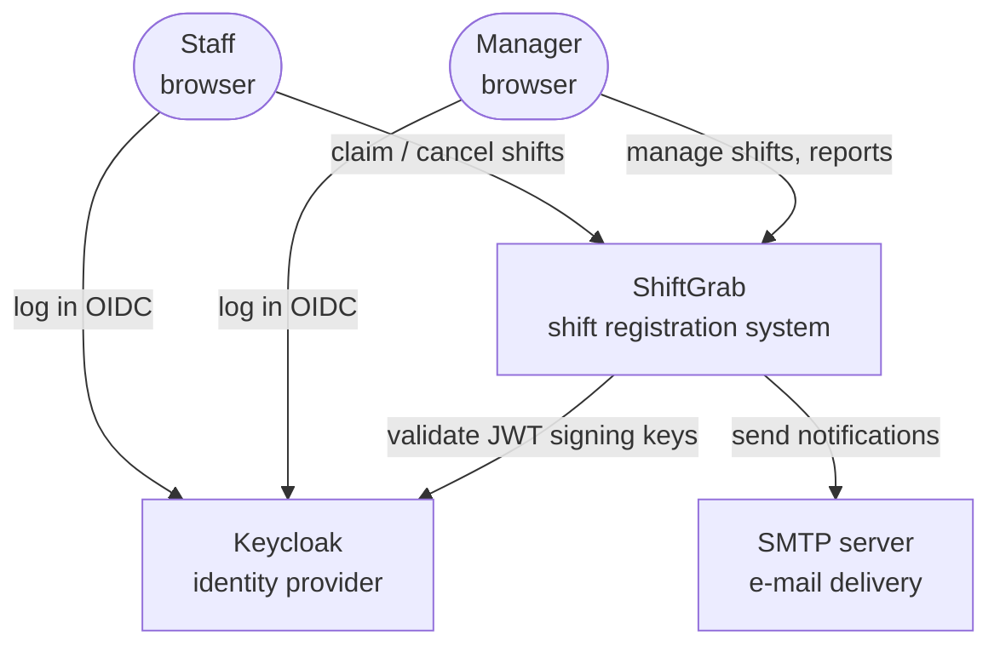
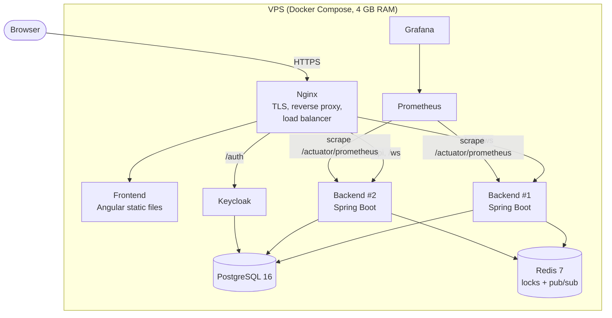
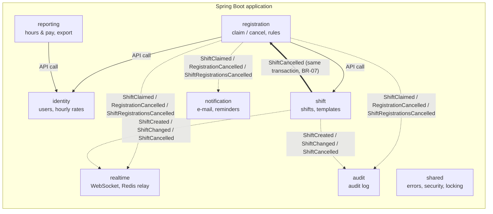
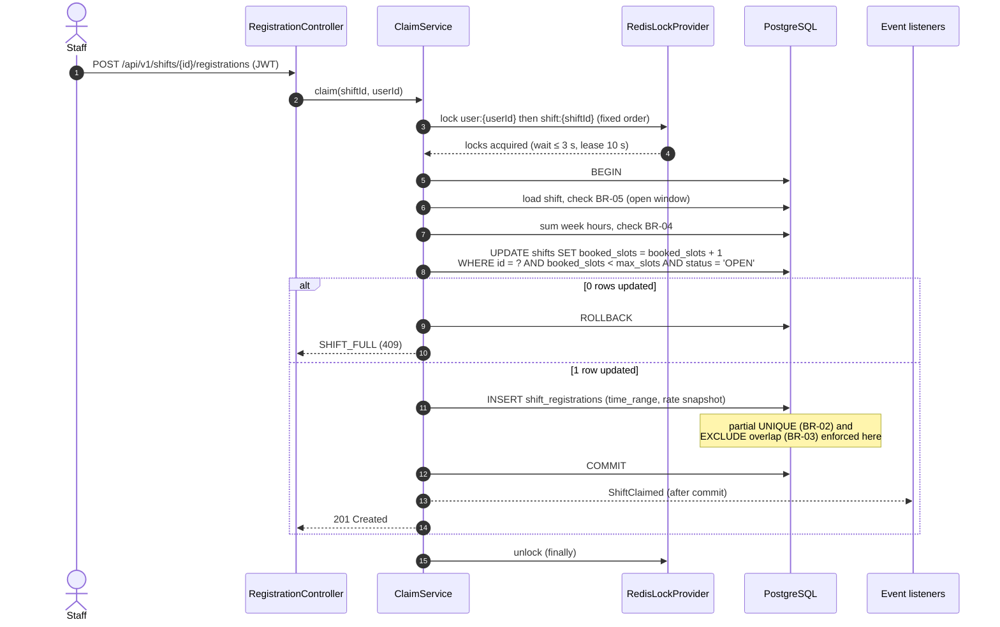
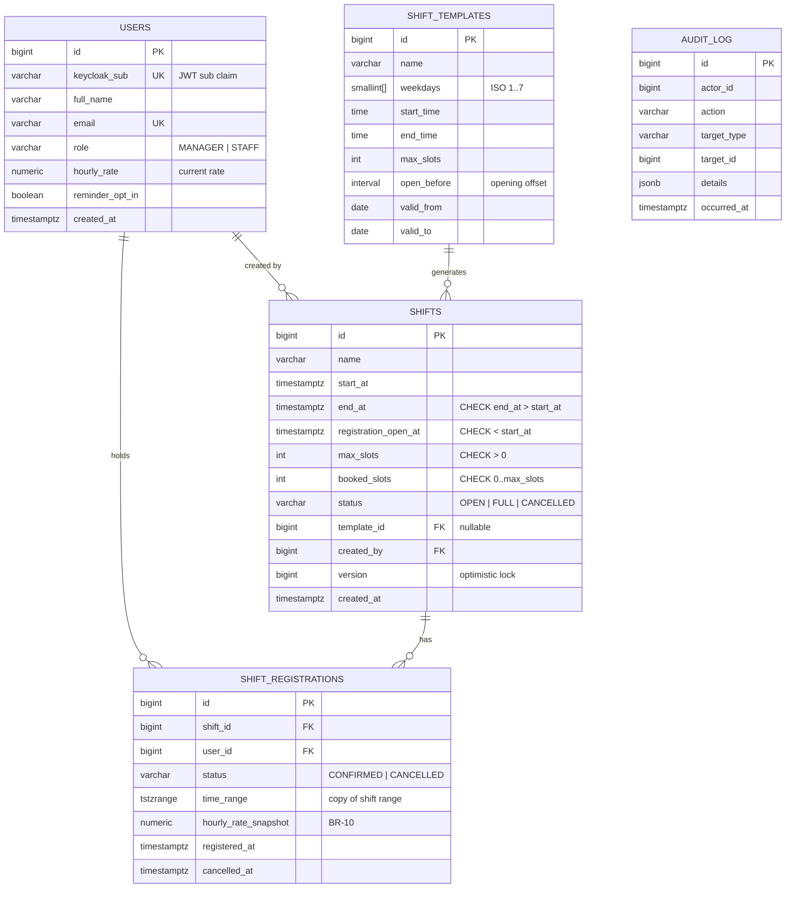

# System Design — ShiftGrab

> Diagrams are language-neutral; each section has an English explanation followed by a Vietnamese one (🇻🇳).
> Requirements referenced as `BR-xx` / `NFR-xx` / `SG-xx` come from the [SRS](../srs/SRS.md).

## 1. System context (C4 level 1)

ShiftGrab delegates authentication entirely to Keycloak: the browser obtains tokens via OIDC Authorization Code + PKCE; the backend only validates JWT signatures and never sees passwords.

🇻🇳 ShiftGrab giao toàn bộ việc xác thực cho Keycloak: trình duyệt lấy token qua OIDC Authorization Code + PKCE; backend chỉ kiểm tra chữ ký JWT và không bao giờ nhìn thấy mật khẩu.

## 2. Containers (C4 level 2) — production deployment

Two backend instances run deliberately: it proves the system is stateless (NFR-03) and that the locking strategy works across processes, not just across threads. WebSocket connections are sticky to one instance, so slot updates are fanned out through Redis pub/sub (SG-40).

🇻🇳 Cố ý chạy hai instance backend để chứng minh hệ thống stateless (NFR-03) và cơ chế khóa hoạt động giữa các tiến trình, không chỉ giữa các thread. Kết nối WebSocket gắn với một instance, nên cập nhật số suất được phát tán qua Redis pub/sub (SG-40).

## 3. Backend modules (C4 level 3)

`ShiftCancelled` is the one event handled **synchronously inside the publishing transaction**: the registration module cancels the shift's registrations there, so BR-07 is all-or-nothing without `shift` depending on `registration` (which would create a cycle). It then publishes `ShiftRegistrationsCancelled` with the affected staff for the after-commit notification (SG-22, SG-41).

🇻🇳 `ShiftCancelled` là event duy nhất được xử lý **đồng bộ trong cùng transaction**: module registration hủy các đăng ký của ca ngay trong đó, nên BR-07 là tất cả hoặc không mà `shift` không phải phụ thuộc `registration` (tránh phụ thuộc vòng). Sau đó nó phát `ShiftRegistrationsCancelled` kèm danh sách nhân viên bị ảnh hưởng để gửi thông báo sau commit (SG-22, SG-41).

Rules (verified by `ApplicationModules.verify()` in a test):
- A module exposes only its root package (public API). Internal packages (`*.internal`) are not accessible from other modules.
- Synchronous calls only where the caller needs the answer to continue (e.g. `registration` needs shift data). Side effects (e-mail, WebSocket, audit) react to **domain events** with `@TransactionalEventListener(phase = AFTER_COMMIT)`, so they never run for a rolled-back claim and never slow it down (SG-41).
- No circular dependencies.

🇻🇳 Quy tắc (kiểm tra tự động bằng test `ApplicationModules.verify()`):
- Module chỉ công khai package gốc (API công khai). Package nội bộ (`*.internal`) không được module khác truy cập.
- Chỉ gọi đồng bộ khi bên gọi cần kết quả để làm tiếp (ví dụ `registration` cần dữ liệu ca). Tác vụ phụ (email, WebSocket, audit) phản ứng với **domain event** qua `@TransactionalEventListener(phase = AFTER_COMMIT)`, nên không chạy khi giành ca bị rollback và không làm chậm request (SG-41).
- Không có phụ thuộc vòng.

## 4. Claim flow — the core of the system (SG-30)

### Three layers of defence against overbooking (BR-01, NFR-01)

| Layer | Mechanism | What it protects against | If it is missing |
|---|---|---|---|
| 1. Distributed lock | Redisson lock per user and per shift | Serialises claims so business-rule checks (BR-04) read a consistent state; keeps contention off the database | Weekly-hour limit could be exceeded by two parallel claims of the same user |
| 2. Atomic conditional update | `UPDATE ... WHERE booked_slots < max_slots` | Overbooking even if the lock expires (GC pause, Redis failover) | Lock expiry → two transactions both see a free slot |
| 3. Database constraints | `CHECK (booked_slots <= max_slots)`, partial `UNIQUE`, `EXCLUDE USING gist` | Any bug in application code; direct SQL | Data corruption becomes possible |

Lock ordering (user → shift) prevents deadlocks between two claims that would otherwise lock in different orders. The lock lease (10 s) is a safety net, not a correctness guarantee — that is why layers 2 and 3 exist.

🇻🇳 **Ba lớp phòng thủ chống overbooking:** (1) khóa phân tán Redisson theo user và theo ca, giúp tuần tự hóa việc kiểm tra quy tắc (BR-04) và giảm tải cho DB; (2) câu lệnh `UPDATE ... WHERE booked_slots < max_slots` nguyên tử, vẫn đúng kể cả khi lock hết hạn (GC pause, Redis failover); (3) ràng buộc database (`CHECK`, partial `UNIQUE`, `EXCLUDE`) chặn mọi lỗi ở tầng ứng dụng. Thứ tự khóa cố định user → ca giúp tránh deadlock. Thời hạn lock 10 giây chỉ là lưới an toàn, không phải bảo đảm tính đúng đắn; đó là lý do cần lớp 2 và 3.

## 5. Data model (ERD)

### Key constraints and indexes

| Object | Definition | Requirement |
|---|---|---|
| `uq_active_registration` | `UNIQUE (shift_id, user_id) WHERE status = 'CONFIRMED'` (partial index) | BR-02 — allows re-claiming after cancel, fixing the old full-table `UNIQUE` |
| `ex_no_overlap` | `EXCLUDE USING gist (user_id WITH =, shift_id WITH <>, time_range WITH &&) WHERE (status = 'CONFIRMED')` (needs `btree_gist`) | BR-03 enforced by the database, even under concurrency. `shift_id WITH <>` (migration V2) leaves same-shift duplicates to `uq_active_registration`, so each rule maps to exactly one error code |
| `ck_slots` | `CHECK (booked_slots BETWEEN 0 AND max_slots)` | BR-01 last line of defence |
| `idx_shifts_start_status` | `(start_at, status)` | SG-24 listing |
| `uq_shifts_template_start` | `UNIQUE (template_id, start_at) WHERE template_id IS NOT NULL` (migration V3) | SG-23 idempotent generation via `ON CONFLICT DO NOTHING`, safe under concurrent generation |
| `idx_reg_user_range` | `(user_id) WHERE status='CONFIRMED'` + gist on `time_range` | BR-04 weekly sum, SG-32 |
| `audit_log` | no `UPDATE`/`DELETE` granted to the application role | NFR-10 append-only |

`time_range` duplicates the shift's time window on purpose: an `EXCLUDE` constraint can only compare columns of the same table. BR-09 (shift time is frozen once registrations exist) keeps the copy consistent.

🇻🇳 `time_range` cố ý sao chép khoảng thời gian của ca, vì ràng buộc `EXCLUDE` chỉ so sánh được các cột trong cùng một bảng. Quy tắc BR-09 (không đổi giờ ca khi đã có người đăng ký) giữ cho bản sao luôn nhất quán. Partial unique index sửa lỗi của schema cũ: trước đây `UNIQUE (shift_id, user_id)` áp lên mọi bản ghi nên nhân viên đã hủy không thể giành lại ca.

## 6. API overview

| Method | Path | Role | Story |
|---|---|---|---|
| GET | `/api/v1/me` | any | SG-10 |
| GET | `/api/v1/shifts?from&to&status&page` | any | SG-24 |
| GET | `/api/v1/shifts/{id}` (returns `ETag`) | any | SG-20 |
| POST | `/api/v1/shifts` | MANAGER | SG-20 |
| PATCH | `/api/v1/shifts/{id}` (`If-Match` required) | MANAGER | SG-21 |
| POST | `/api/v1/shifts/{id}/cancel` | MANAGER | SG-22 |
| POST, GET | `/api/v1/shift-templates`, `/api/v1/shift-templates/{id}` | MANAGER | SG-23 |
| POST | `/api/v1/shift-templates/{id}/generate` (idempotent) | MANAGER | SG-23 |
| PUT | `/api/v1/users/{id}/hourly-rate` | MANAGER | SG-25 |
| POST | `/api/v1/shifts/{id}/registrations` | STAFF | SG-30 |
| DELETE | `/api/v1/registrations/{id}` | STAFF (owner) | SG-31 |
| GET | `/api/v1/me/registrations` | STAFF | SG-32 |
| GET | `/api/v1/reports/hours?from&to&format=json\|csv\|xlsx` | MANAGER | SG-50, SG-51 |
| GET | `/api/v1/audit-log?actor&action&from&to` | MANAGER | SG-52 |
| WS | `/ws` → topic `/topic/shifts` | any | SG-40 |

Full contract is generated by springdoc at `/swagger-ui.html` and is the source of truth.

## 7. Cross-cutting concerns

| Concern | Approach |
|---|---|
| Time | Store UTC (`TIMESTAMPTZ`), compute weeks in `Asia/Ho_Chi_Minh`, inject `java.time.Clock` so tests control "now" |
| Errors | `@RestControllerAdvice` → `ProblemDetail` with `code` (SRS §6) |
| Validation | Bean Validation on DTOs; business rules in the domain service |
| Config | `application.yml` + profiles `local`, `test`, `prod`; secrets only from env vars |
| Observability | Micrometer counters `shiftgrab.claims{result}`, timer `shiftgrab.lock.wait`; JSON logs with trace id |
| Testing | Unit (Mockito), slice (`@WebMvcTest`), integration (Testcontainers Postgres + Redis + Keycloak), concurrency (`ExecutorService` + `CountDownLatch`), architecture (Spring Modulith) |
