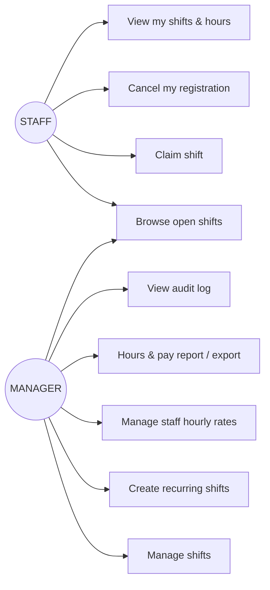

# Software Requirements Specification — ShiftGrab

> 🇻🇳 [Bản tiếng Việt](SRS.vi.md) · Version 1.0 · Status: Approved for Sprint 1

## 1. Introduction

### 1.1 Purpose
This document specifies the functional and non-functional requirements of **ShiftGrab**, a system in which managers publish work shifts with a limited number of slots and staff claim them, often at the same moment a shift opens for registration.

### 1.2 Scope
In scope: shift management, recurring shifts, shift claiming and cancellation under concurrency, business-rule enforcement, real-time slot updates, e-mail notifications, audit log, hours & pay reports, authentication/authorisation, deployment and monitoring.

Out of scope (v1): payroll integration, shift swapping between staff, mobile apps, multi-tenant organisations, skill/certificate matching.

### 1.3 Glossary

| Term | Meaning |
|---|---|
| Shift | A time window `[start_at, end_at)` with `max_slots` positions |
| Slot | One position in a shift that one staff member can hold |
| Claim | A staff member's request to take a slot (creates a *registration*) |
| Registration | The link between a staff member and a shift; `CONFIRMED` or `CANCELLED` |
| Opening time | `registration_open_at` — the instant from which a shift can be claimed |
| Overbooking | More confirmed registrations than `max_slots`. Must never happen |
| Week | ISO week (Monday 00:00 – Sunday 24:00) in the organisation time zone `Asia/Ho_Chi_Minh` |

## 2. Overall description

### 2.1 Actors

| Actor | Description |
|---|---|
| **STAFF** | Employee who browses, claims and cancels shifts |
| **MANAGER** | Creates/edits/cancels shifts, defines recurring templates, sets hourly rates, views reports and audit log |
| **System** | Scheduler that sends reminders; Keycloak as identity provider |

### 2.2 Use-case overview



### 2.3 Constraints
- Backend Java 21 / Spring Boot 3; frontend Angular; PostgreSQL; Keycloak; Redis.
- Runs as Docker containers on a single 4 GB VPS, with ≥ 2 backend instances behind Nginx.
- All timestamps stored in UTC (`TIMESTAMPTZ`); displayed in the user's time zone.

## 3. Business rules

| ID | Rule |
|---|---|
| **BR-01** | Confirmed registrations of a shift never exceed `max_slots` (no overbooking). |
| **BR-02** | A staff member holds at most one confirmed registration per shift. After cancelling, they may claim the same shift again. |
| **BR-03** | A staff member cannot hold two confirmed shifts whose time ranges overlap. |
| **BR-04** | Total hours of a staff member's confirmed shifts in one week must not exceed the weekly limit (default **40 h**, configurable). |
| **BR-05** | A shift can be claimed only when `status = OPEN`, `now ≥ registration_open_at` and `now < start_at`. |
| **BR-06** | Staff may cancel only until `start_at − cancel deadline` (default **24 h**, configurable). The slot is released immediately. |
| **BR-07** | When a manager cancels a shift, all its confirmed registrations are cancelled and affected staff are notified. |
| **BR-08** | `max_slots` cannot be reduced below the number of confirmed registrations. |
| **BR-09** | Start/end time of a shift cannot be changed once it has confirmed registrations (cancel and recreate instead). |
| **BR-10** | Pay is computed with the hourly rate **snapshotted at claim time**, so later rate changes do not alter past pay. |
| **BR-11** | A shift's status is `FULL` when confirmed registrations = `max_slots`, and returns to `OPEN` when a slot is released. |

## 4. Functional requirements (user stories)

Each story has acceptance criteria (AC) in Given/When/Then form. IDs `SG-xx` match the GitHub issues.

### Epic E1 — Identity & access

**SG-10 — Login with company account.** *As a user, I want to log in via Keycloak so that I can access features for my role.*
- AC1: Given valid credentials, when I log in, then I am redirected back with a session and see the menu for my role.
- AC2: Given a request without a valid token, when it hits `/api/**`, then the API returns `401`.
- AC3: Given a STAFF token, when I call a manager endpoint, then the API returns `403`.
- AC4: Given my first successful API call, then a local user profile is created from my token claims (sub, name, e-mail, role).

### Epic E2 — Shift management (MANAGER)

**SG-20 — Create a shift.** *As a manager, I want to create a shift with time, slots and opening time.*
- AC1: Given valid data (`end_at > start_at`, `max_slots ≥ 1`, `registration_open_at < start_at`), when I submit, then the shift is created with status `OPEN` and `booked_slots = 0`.
- AC2: Given invalid data, then I receive `400` with field-level errors.

**SG-21 — Edit a shift.** AC: name and `max_slots` can be changed subject to BR-08; time changes are rejected per BR-09 with `409`. Concurrent edits are detected (optimistic locking) and the second one gets `409`.

**SG-22 — Cancel a shift.** AC: Given a shift with registrations, when I cancel it, then its status becomes `CANCELLED`, all registrations become `CANCELLED` (BR-07), and staff receive an e-mail.

**SG-23 — Recurring shifts.** *As a manager, I want to generate shifts from a template (weekdays, time, slots, date range).*
- AC1: Given template Mon–Fri 08:00–12:00, 3 slots, for 4 weeks, when I generate, then 20 shifts are created.
- AC2: Generation is all-or-nothing (single transaction).

**SG-24 — Browse shifts.** AC: filter by date range and status, paginated, sorted by `start_at`; staff see only `OPEN`/`FULL` future shifts.

**SG-25 — Manage hourly rates.** AC: manager can set a staff member's hourly rate; the change applies to future claims only (BR-10).

### Epic E3 — Claiming (core)

**SG-30 — Claim a shift.** *As staff, I want to claim a slot so that I get the shift.*
- AC1: Given an open shift with free slots and no rule violation, when I claim, then I get `201` and a `CONFIRMED` registration; `booked_slots` increases by 1.
- AC2: Given the shift is full, then `409 SHIFT_FULL`.
- AC3: Given before opening time, then `409 REGISTRATION_NOT_OPEN`.
- AC4: Given an overlapping confirmed shift, then `409 SHIFT_OVERLAP`.
- AC5: Given the weekly limit would be exceeded, then `409 WEEKLY_LIMIT_EXCEEDED`.
- AC6: Given I already hold this shift, then `409 ALREADY_REGISTERED` (idempotent double-click).
- AC7: **Given N concurrent claims on a shift with M slots (N > M), across multiple backend instances, then exactly M succeed and the rest get `SHIFT_FULL`.**

**SG-31 — Cancel my registration.** AC: before the deadline → `204`, slot released, shift back to `OPEN` (BR-11); after → `409 CANCEL_DEADLINE_PASSED`.

**SG-32 — My shifts.** AC: list my upcoming and past registrations with total hours for the current week.

### Epic E4 — Real-time & notifications

**SG-40 — Live slot updates.** AC: Given two users viewing the same shift list, when one claims, then the other sees the remaining slots update within 1 s without reloading, regardless of which backend instance served the claim.

**SG-41 — E-mail notifications.** AC: e-mail on successful claim, on cancellation, and when a manager cancels a shift; sending failures never roll back the claim.

**SG-42 — Opening reminder.** AC: staff who opted in receive an e-mail 30 min before a shift opens; with 2 instances each reminder is sent exactly once.

### Epic E5 — Reporting & audit

**SG-50 — Hours & pay report.** AC: for a date range, per staff member: number of shifts, total hours, total pay (BR-10); totals row.
**SG-51 — Export.** AC: download the report as CSV and XLSX.
**SG-52 — Audit log.** AC: every create/edit/cancel/claim records actor, action, target, timestamp, before/after summary; managers can filter by actor, action and date.

## 5. Non-functional requirements

| ID | Category | Requirement |
|---|---|---|
| NFR-01 | Correctness | Zero overbooking and zero overlap violations under any concurrency (verified by automated concurrency tests and k6). |
| NFR-02 | Performance | Claim endpoint p95 < 300 ms at 500 requests/s on the target VPS (2 backend instances). |
| NFR-03 | Scalability | Backend is stateless; adding instances requires no code change. |
| NFR-04 | Security | OAuth2/OIDC with JWT; role-based authorisation; OWASP Top 10 mitigations; secrets only via environment variables; HTTPS only in production. |
| NFR-05 | Availability | Health checks and automatic container restart; zero-downtime is not required in v1. |
| NFR-06 | Backup | Daily database backup, 7-day retention. RPO 24 h, RTO 1 h. |
| NFR-07 | Observability | Metrics (Prometheus), dashboards (Grafana), structured JSON logs with trace id. |
| NFR-08 | Maintainability | Module boundaries verified by tests; line coverage ≥ 70 %; CI blocks merge on failure. |
| NFR-09 | Usability | UI available in Vietnamese and English; responsive down to 360 px width. |
| NFR-10 | Auditability | Audit records are append-only and kept ≥ 1 year. |

## 6. Error contract

All API errors use RFC 7807 `application/problem+json` with an extra `code` field:
`VALIDATION_FAILED`, `SHIFT_NOT_FOUND`, `SHIFT_FULL`, `REGISTRATION_NOT_OPEN`, `SHIFT_OVERLAP`, `WEEKLY_LIMIT_EXCEEDED`, `ALREADY_REGISTERED`, `CANCEL_DEADLINE_PASSED`, `CONCURRENT_MODIFICATION`, `SHIFT_HAS_REGISTRATIONS`.

Generic codes cover every other error so that clients can always branch on `code`: `MALFORMED_REQUEST` (400), `UNAUTHORIZED` (401), `FORBIDDEN` (403), `NOT_FOUND` (404), `METHOD_NOT_ALLOWED` (405), `DATA_CONFLICT` (409, unmapped database constraint), `INTERNAL_ERROR` (500, no internal details exposed). `VALIDATION_FAILED` adds `errors: [{field, message}]`.

```json
{ "type": "about:blank", "title": "Shift is full", "status": 409, "detail": "…",
  "instance": "/api/v1/shifts/42/registrations", "code": "SHIFT_FULL" }
```
