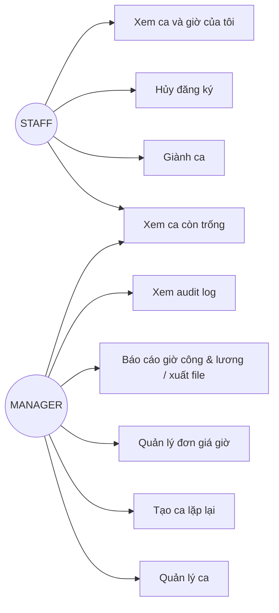

# Đặc tả Yêu cầu Phần mềm — ShiftGrab

> 🇬🇧 [English version](SRS.md) · Phiên bản 1.0 · Trạng thái: Đã duyệt cho Sprint 1

## 1. Giới thiệu

### 1.1 Mục đích
Tài liệu này đặc tả các yêu cầu chức năng và phi chức năng của **ShiftGrab**: hệ thống trong đó quản lý đăng các ca làm việc có số suất giới hạn, và nhân viên giành ca, thường là cùng lúc ngay khi ca mở đăng ký.

### 1.2 Phạm vi
Trong phạm vi: quản lý ca, ca lặp lại, giành/hủy ca khi có tranh chấp đồng thời, áp dụng quy tắc nghiệp vụ, cập nhật suất real-time, thông báo email, audit log, báo cáo giờ công & lương, xác thực/phân quyền, triển khai và giám sát.

Ngoài phạm vi (v1): tích hợp bảng lương, đổi ca giữa nhân viên, ứng dụng di động, đa tổ chức (multi-tenant), ghép ca theo kỹ năng/chứng chỉ.

### 1.3 Thuật ngữ

| Thuật ngữ | Ý nghĩa |
|---|---|
| Ca (Shift) | Khoảng thời gian `[start_at, end_at)` với `max_slots` suất |
| Suất (Slot) | Một vị trí trong ca, một nhân viên giữ được một suất |
| Giành ca (Claim) | Yêu cầu nhận một suất của nhân viên, tạo ra một *bản đăng ký* |
| Bản đăng ký (Registration) | Liên kết giữa nhân viên và ca; trạng thái `CONFIRMED` hoặc `CANCELLED` |
| Giờ mở đăng ký | `registration_open_at`, thời điểm bắt đầu được giành ca |
| Overbooking | Số bản đăng ký CONFIRMED vượt `max_slots`. Không bao giờ được xảy ra |
| Tuần | Tuần ISO (00:00 thứ Hai – 24:00 Chủ nhật) theo múi giờ `Asia/Ho_Chi_Minh` |

## 2. Mô tả tổng quan

### 2.1 Tác nhân

| Tác nhân | Mô tả |
|---|---|
| **STAFF** | Nhân viên xem, giành và hủy ca |
| **MANAGER** | Tạo/sửa/hủy ca, định nghĩa mẫu ca lặp lại, đặt đơn giá giờ, xem báo cáo và audit log |
| **Hệ thống** | Bộ lập lịch gửi nhắc nhở; Keycloak làm nhà cung cấp định danh |

### 2.2 Tổng quan use case



### 2.3 Ràng buộc
- Backend Java 21 / Spring Boot 3; frontend Angular; PostgreSQL; Keycloak; Redis.
- Chạy dạng container Docker trên một VPS 4 GB, có ≥ 2 instance backend sau Nginx.
- Mọi mốc thời gian lưu ở UTC (`TIMESTAMPTZ`), hiển thị theo múi giờ người dùng.

## 3. Quy tắc nghiệp vụ

| Mã | Quy tắc |
|---|---|
| **BR-01** | Số bản đăng ký CONFIRMED của một ca không bao giờ vượt `max_slots` (không overbooking). |
| **BR-02** | Mỗi nhân viên giữ tối đa một bản đăng ký CONFIRMED cho mỗi ca. Sau khi hủy có thể giành lại ca đó. |
| **BR-03** | Nhân viên không được giữ hai ca CONFIRMED có khoảng thời gian chồng nhau. |
| **BR-04** | Tổng giờ các ca CONFIRMED của nhân viên trong một tuần không vượt hạn mức (mặc định **40 giờ**, cấu hình được). |
| **BR-05** | Chỉ giành được ca khi `status = OPEN`, `now ≥ registration_open_at` và `now < start_at`. |
| **BR-06** | Nhân viên chỉ được hủy trước `start_at − hạn hủy` (mặc định **24 giờ**, cấu hình được). Suất được trả lại ngay. |
| **BR-07** | Khi quản lý hủy ca, mọi bản đăng ký CONFIRMED của ca bị hủy và nhân viên liên quan được thông báo. |
| **BR-08** | Không được giảm `max_slots` xuống dưới số bản đăng ký CONFIRMED hiện có. |
| **BR-09** | Không được đổi giờ bắt đầu/kết thúc khi ca đã có người đăng ký (phải hủy và tạo lại). |
| **BR-10** | Tiền công tính theo đơn giá giờ **chụp lại tại thời điểm giành ca**, nên đổi đơn giá về sau không làm thay đổi tiền công quá khứ. |
| **BR-11** | Ca có trạng thái `FULL` khi số CONFIRMED = `max_slots`, và quay lại `OPEN` khi có suất được trả. |

## 4. Yêu cầu chức năng (user story)

Mỗi story có tiêu chí nghiệm thu (AC) dạng Given/When/Then. Mã `SG-xx` trùng với issue trên GitHub.

### Epic E1: Định danh & truy cập

**SG-10: Đăng nhập bằng tài khoản công ty.** *Là người dùng, tôi muốn đăng nhập qua Keycloak để dùng các chức năng theo vai trò.*
- AC1: Với thông tin đăng nhập hợp lệ, khi đăng nhập thì tôi được chuyển về ứng dụng và thấy menu theo vai trò.
- AC2: Request không có token hợp lệ gọi `/api/**` thì API trả `401`.
- AC3: Token STAFF gọi endpoint của manager thì API trả `403`.
- AC4: Ở lần gọi API thành công đầu tiên, hệ thống tạo hồ sơ người dùng nội bộ từ thông tin trong token (sub, tên, email, vai trò).

### Epic E2: Quản lý ca (MANAGER)

**SG-20: Tạo ca.** *Là quản lý, tôi muốn tạo ca với thời gian, số suất và giờ mở đăng ký.*
- AC1: Với dữ liệu hợp lệ (`end_at > start_at`, `max_slots ≥ 1`, `registration_open_at < start_at`), ca được tạo với trạng thái `OPEN`, `booked_slots = 0`.
- AC2: Dữ liệu không hợp lệ thì nhận `400` kèm lỗi từng trường.
- AC3 *(làm rõ ở Sprint 2)*: `start_at` phải ở tương lai và một ca dài tối đa **12 giờ**.

**SG-21: Sửa ca.** AC: đổi được tên và `max_slots` theo BR-08; đổi giờ bị từ chối theo BR-09 với `409`. Hai người sửa cùng lúc thì người thứ hai nhận `409` (optimistic locking). *Làm rõ:* `GET` trả phiên bản trong header `ETag`; `PATCH` bắt buộc `If-Match` (thiếu → `428 PRECONDITION_REQUIRED`, lệch phiên bản → `409 CONCURRENT_MODIFICATION`).

**SG-22: Hủy ca.** AC: Ca đã có người đăng ký, khi hủy thì trạng thái ca thành `CANCELLED`, mọi bản đăng ký thành `CANCELLED` (BR-07), nhân viên nhận email. *Làm rõ:* Sprint 2 hủy tất cả trong một transaction và phát event kèm danh sách nhân viên bị ảnh hưởng; email do SG-41 gửi khi có listener.

**SG-23: Ca lặp lại.** *Là quản lý, tôi muốn sinh ca hàng loạt từ mẫu (ngày trong tuần, giờ, số suất, khoảng ngày).*
- AC1: Mẫu Thứ 2–6, 08:00–12:00, 3 suất, trong 4 tuần thì sinh ra 20 ca.
- AC2: Việc sinh ca là tất cả hoặc không (một transaction).
- AC3 *(làm rõ)*: Sinh lại là idempotent: ca đã tồn tại của mẫu được bỏ qua và báo lại, không tạo trùng. Ngày đã qua cũng bỏ qua.

**SG-24: Xem danh sách ca.** AC: lọc theo khoảng ngày và trạng thái, phân trang, sắp theo `start_at`; nhân viên chỉ thấy ca tương lai `OPEN`/`FULL`.

**SG-25: Quản lý đơn giá giờ.** AC: quản lý đặt đơn giá giờ cho nhân viên; chỉ áp dụng cho các lần giành ca sau đó (BR-10).

### Epic E3: Giành ca (lõi hệ thống)

**SG-30: Giành ca.** *Là nhân viên, tôi muốn giành một suất để nhận ca.*
- AC1: Ca đang mở, còn suất, không vi phạm quy tắc thì nhận `201` và bản đăng ký `CONFIRMED`; `booked_slots` tăng 1.
- AC2: Ca đã đầy thì `409 SHIFT_FULL`.
- AC3: Chưa tới giờ mở thì `409 REGISTRATION_NOT_OPEN`.
- AC4: Trùng giờ với ca đã giữ thì `409 SHIFT_OVERLAP`.
- AC5: Vượt hạn mức giờ/tuần thì `409 WEEKLY_LIMIT_EXCEEDED`.
- AC6: Đã giữ ca này rồi thì `409 ALREADY_REGISTERED` (chống bấm đúp).
- AC7: **N request giành đồng thời vào ca có M suất (N > M), trên nhiều instance backend, thì đúng M request thành công, phần còn lại nhận `SHIFT_FULL`.**
- *Làm rõ ở Sprint 3:* request không lấy được khóa trong 3 giây thì nhận `503 CLAIM_BUSY` kèm `Retry-After` (không báo nhầm là ca đã đầy). Nếu dịch vụ khóa (Redis) sập thì việc giành ca bị từ chối với `503 LOCK_UNAVAILABLE`; mọi chức năng khác vẫn chạy. Với BR-04, ca vắt qua ranh giới tuần được tính giờ vào từng tuần ISO theo phần thời gian thực tế nằm trong tuần đó. Hạn mức 40 giờ/tuần và hạn hủy 24 giờ là cấu hình triển khai.

**SG-31: Hủy đăng ký.** AC: trước hạn thì `204`, suất được trả, ca về `OPEN` (BR-11); quá hạn thì `409 CANCEL_DEADLINE_PASSED`.

**SG-32: Ca của tôi.** AC: liệt kê các ca sắp tới và đã qua, kèm tổng giờ của tuần hiện tại.

### Epic E4: Real-time & thông báo

**SG-40: Cập nhật suất trực tiếp.** AC: Hai người cùng xem danh sách ca, khi một người giành thì người kia thấy số suất còn lại thay đổi trong vòng 1 giây mà không cần tải lại, bất kể instance backend nào xử lý request.

**SG-41: Thông báo email.** AC: gửi email khi giành ca thành công, khi hủy, khi quản lý hủy ca; lỗi gửi email không làm rollback việc giành ca.

**SG-42: Nhắc giờ mở đăng ký.** AC: nhân viên bật nhận nhắc sẽ nhận email 30 phút trước khi ca mở; với 2 instance thì mỗi nhắc nhở chỉ gửi đúng một lần.

### Epic E5: Báo cáo & audit

**SG-50: Báo cáo giờ công & lương.** AC: theo khoảng ngày, với mỗi nhân viên: số ca, tổng giờ, tổng tiền (BR-10); có dòng tổng.
**SG-51: Xuất file.** AC: tải báo cáo dạng CSV và XLSX.
**SG-52: Audit log.** AC: mọi thao tác tạo/sửa/hủy/giành đều ghi người thực hiện, hành động, đối tượng, thời điểm, tóm tắt trước/sau; quản lý lọc được theo người, hành động, ngày.

## 5. Yêu cầu phi chức năng

| Mã | Nhóm | Yêu cầu |
|---|---|---|
| NFR-01 | Tính đúng đắn | Không overbooking và không vi phạm trùng giờ dưới mọi mức đồng thời (kiểm chứng bằng test concurrency tự động và k6). |
| NFR-02 | Hiệu năng | Endpoint giành ca có p95 < 300 ms ở 500 request/giây trên VPS mục tiêu (2 instance backend). |
| NFR-03 | Mở rộng | Backend stateless; thêm instance không cần sửa code. |
| NFR-04 | Bảo mật | OAuth2/OIDC với JWT; phân quyền theo vai trò; giảm thiểu OWASP Top 10; secrets chỉ qua biến môi trường; production chỉ dùng HTTPS. |
| NFR-05 | Sẵn sàng | Health check và tự khởi động lại container; v1 không yêu cầu zero-downtime. |
| NFR-06 | Sao lưu | Backup database hằng ngày, giữ 7 ngày. RPO 24 giờ, RTO 1 giờ. |
| NFR-07 | Quan sát | Metrics (Prometheus), dashboard (Grafana), log JSON có trace id. |
| NFR-08 | Bảo trì | Ranh giới module được kiểm tra bằng test; line coverage ≥ 70 %; CI chặn merge khi thất bại. |
| NFR-09 | Khả dụng | Giao diện tiếng Việt và tiếng Anh; responsive tới 360 px. |
| NFR-10 | Kiểm toán | Bản ghi audit chỉ thêm mới (append-only), lưu ≥ 1 năm. |

## 6. Quy ước lỗi

Mọi lỗi API theo RFC 7807 `application/problem+json`, kèm trường `code`:
`VALIDATION_FAILED`, `SHIFT_NOT_FOUND`, `SHIFT_FULL`, `REGISTRATION_NOT_OPEN`, `SHIFT_OVERLAP`, `WEEKLY_LIMIT_EXCEEDED`, `ALREADY_REGISTERED`, `CANCEL_DEADLINE_PASSED`, `CONCURRENT_MODIFICATION`, `SHIFT_HAS_REGISTRATIONS`.

Mã cho quản lý ca (Sprint 2): `SHIFT_CANCELLED` (409), `SHIFT_ALREADY_STARTED` (409), `TEMPLATE_NOT_FOUND` (404), `USER_NOT_FOUND` (404), `PRECONDITION_REQUIRED` (428, thiếu `If-Match`).

Giành ca khi tải cao (Sprint 3): `CLAIM_BUSY` (503, `Retry-After: 1`), `LOCK_UNAVAILABLE` (503, `Retry-After: 5`).

Các mã chung cho mọi lỗi còn lại, để client luôn rẽ nhánh theo `code`: `MALFORMED_REQUEST` (400), `UNAUTHORIZED` (401), `FORBIDDEN` (403), `NOT_FOUND` (404), `METHOD_NOT_ALLOWED` (405), `DATA_CONFLICT` (409, ràng buộc CSDL chưa được ánh xạ), `INTERNAL_ERROR` (500, không lộ chi tiết nội bộ). `VALIDATION_FAILED` có thêm `errors: [{field, message}]`.

```json
{ "type": "about:blank", "title": "Shift is full", "status": 409, "detail": "…",
  "instance": "/api/v1/shifts/42/registrations", "code": "SHIFT_FULL" }
```
